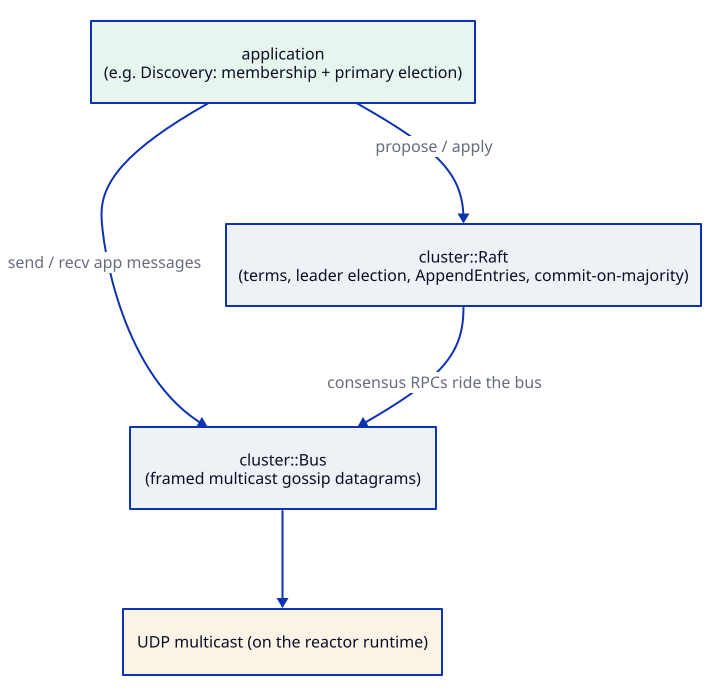

# cluster

[](https://github.com/Kronuz/cluster/actions/workflows/ci.yml)
[](LICENSE)


A UDP-multicast cluster substrate for C++20: a typed message bus and leader election
on the [reactor](https://github.com/Kronuz/reactor) Asio runtime. Nodes on one
network find each other and elect a leader; your app decides what a committed
command does.



## ✨ Highlights

- 📡 **`cluster::Bus`**: one multicast socket carrying versioned, typed frames scoped
  by a cluster token; traffic from other clusters or newer protocols is dropped.
- 🗳️ **`cluster::Raft`**: terms, votes, log replication, and commit, with the node
  type and `apply(command)` injected. Elections settle in about 40 ms with a 20–60 ms
  window.
- 💓 **`cluster::LivenessTracker`**: tracks when each peer was last heard, for Raft's
  `is_alive()`.
- 🧵 **One loop**: receives and timers run on the bus reactor, so single-threaded
  protocol code never races.
- 🔁 **Wire-compatible** with Xapiand's discovery frames.

## 📦 Installation

Requires a C++20 compiler and CMake 3.14 or newer; reactor and standalone Asio are
fetched at configure time. CI builds it on Linux (x86_64, arm64), macOS (arm64,
x86_64), and FreeBSD, plus ASan, UBSan, and TSan builds.

```cmake
include(FetchContent)
FetchContent_Declare(cluster
  GIT_REPOSITORY https://github.com/Kronuz/cluster.git
  GIT_TAG        main)
FetchContent_MakeAvailable(cluster)

target_link_libraries(my_app PRIVATE cluster::cluster)
```

## 🚀 Quick start

```cpp
#include "bus.h"

cluster::Bus bus(/*major*/ 1, /*minor*/ 0, /*token*/ "my-cluster", /*max_type*/ 32,
	[](int type, std::string_view content, const asio::ip::udp::endpoint& from) {
		dispatch(type, content, from);   // on the bus reactor thread
	});
reactor::UdpOptions o;
o.multicast_group = "239.192.168.1";
o.multicast_loop = true;                 // one-host clusters see their own sends
o.reuse_port = true;                     // several nodes share the port
bus.set_options(o);
bus.start(58880);
bus.send(5, payload);                    // framed and sent to the group
```

Run the demos: `cluster_gossip` (three nodes announce themselves) and
`cluster_raft_election`.

## 🎯 When to use it

- ✅ Discovery and leader election on one LAN, for state you can rebuild.
- ❌ Durable consensus: terms, votes, and logs here are in memory. Use
  [consensus](https://github.com/Kronuz/consensus) with
  [journal](https://github.com/Kronuz/journal).
- ❌ Membership gossip out of the box: the HELLO/WAVE naming protocol is still the
  application's (see `examples/gossip.cc`).

## 📚 Documentation

- [ARCHITECTURE.md](ARCHITECTURE.md): the layers, the frame, and the threading model.
- [SAFETY.md](SAFETY.md): the Raft safety corrections and what the tests cover.
- [AGENTS.md](AGENTS.md): file map and invariants.

## 🛠️ Building and testing

```sh
cmake -B build -DCMAKE_BUILD_TYPE=Release && cmake --build build
ctest --test-dir build --output-on-failure
./build/cluster_bus_bench && ./build/cluster_raft_bench
```

## 🤝 Contributing

Issues and pull requests are welcome. Read [AGENTS.md](AGENTS.md) first. CI must
pass on every platform.

## 📄 License

MIT, Copyright (c) 2026 Germán Méndez Bravo. See [LICENSE](LICENSE).
